# Desarrollo de Software Seguro Consigna Práctica 2

## Mitigación de vulnerabilidades

### Introducción

El trabajo consistió en analizar cinco aplicaciones intencionalmente vulnerables, generar una prueba de concepto para demostrar cada vulnerabilidad, y posteriormente modificar el código de cada aplicación para mitigar los problemas encontrados.

Las vulnerabilidades trabajadas fueron:

- SQL Injection.
- Cross Site Scripting.
- File Upload inseguro.
- Server Side Template Injection.
- Almacenamiento inseguro de contraseñas.

El trabajo fue realizado utilizando el mismo ambiente de Kali Linux configurado durante el práctico anterior y Docker para levantar las diferentes aplicaciones.

Durante toda la práctica utilice extensivamente ChatGPT como herramienta de asistencia. La IA fue utilizada tanto para encontrar y entender las vulnerabilidades como para generar y analizar pruebas de concepto, entender partes del código que no conocía, decidir como solucionar las vulnerabilidades, diagnosticar problemas que aparecieron durante el proceso, e incluso corregir el lexico del informe.

Todos los cambios, comandos y pruebas fueron aplicados manualmente dentro de la máquina virtual.

Quiero aclarar y disculparme de antemano respecto a la calidad de las imagenes, ya que si bien se pueden ver y entender perfectamente, lo que fui haciendo durante la practica fue sacar screenshots de las cosas que me parecian pertinentes y las pegaba en Whatsapp como pisapapeles para cuando haga el informe, y bueno, la magia de la compresion de Whatsapp hizo su trabajo correctamente (capaz demasiado bien).

## Ejercicio 1 - SQL Injection

### Identificación y explotación

La primera aplicación contiene una vulnerabilidad de SQL Injection en el buscador de películas.

Revisando el código encontré que el valor ingresado por el usuario era agregado directamente dentro de la consulta SQL.

La consulta vulnerable utilizaba el valor de `query` directamente dentro de un string, de forma similar a:

```python
WHERE peliculas.nombre LIKE '%{query}%'
```

Esto significa que en lugar de ser tratado exclusivamente como texto de búsqueda, el valor ingresado podía modificar la estructura de la consulta SQL.

Para comprobarlo utilice el siguiente payload en el buscador:

```text
' UNION SELECT sqlite_version(), '1970-01-01', 0 --
```

La idea del payload era finalizar la búsqueda original y agregar mediante `UNION SELECT` una fila creada por mí, donde el nombre de la película sería reemplazado por el resultado de:

```sql
sqlite_version()
```

El ataque funcionó correctamente.

La aplicación mostró una película adicional cuyo nombre era:

```text
3.46.1
```

acompañada por la fecha artificial:

```text
1970/01/01
```

y cero asientos disponibles.

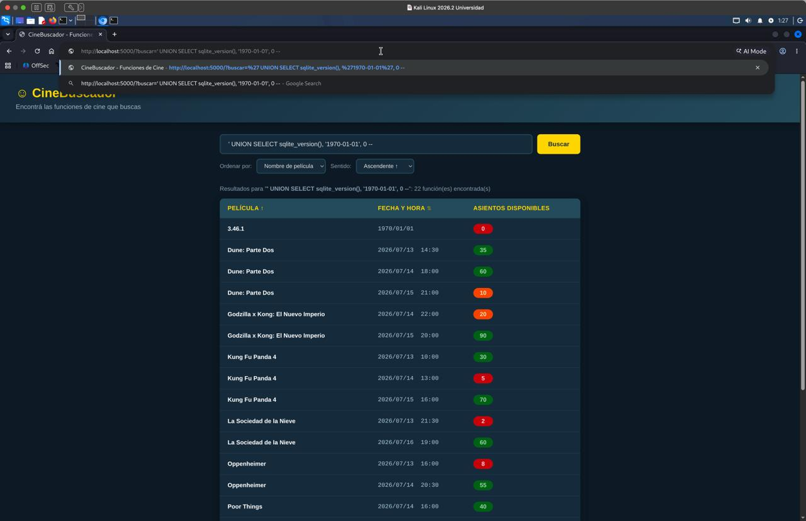

Esto confirmó que el contenido ingresado en el buscador estaba siendo interpretado como parte de la consulta SQL y no únicamente como un valor.

### Mitigación

Para solucionar el problema cambie la consulta para utilizar parámetros.

En lugar de insertar el contenido directamente dentro del SQL:

```python
WHERE peliculas.nombre LIKE '%{query}%'
```

la consulta ahora utiliza:

```python
WHERE peliculas.nombre LIKE ?
```

y el valor es enviado posteriormente mediante:

```python
db.execute(sql, (f'%{query}%',))
```

De esta manera el motor de base de datos diferencia la estructura de la consulta del dato ingresado por el usuario.

Aunque el usuario ingrese caracteres como:

```text
'
--
UNION
SELECT
```

estos pasan a ser tratados como texto y no como instrucciones SQL.

También tuve que considerar los parámetros utilizados para ordenar los resultados.

Como los nombres de columnas y las palabras `ASC` y `DESC` no pueden ser parametrizadas de la misma forma, se utilizaron listas de valores permitidos.

Por ejemplo, solamente se permiten columnas de ordenamiento conocidas por la aplicación y las direcciones:

```text
ASC
DESC
```

Luego de realizar los cambios reconstruí el contenedor mediante:

```bash
docker compose down
docker compose up --build -d
```

y repetí exactamente el mismo payload utilizado anteriormente:

```text
' UNION SELECT sqlite_version(), '1970-01-01', 0 --
```

Esta vez la aplicación respondió que no encontró ninguna función que coincidiera con ese nombre.

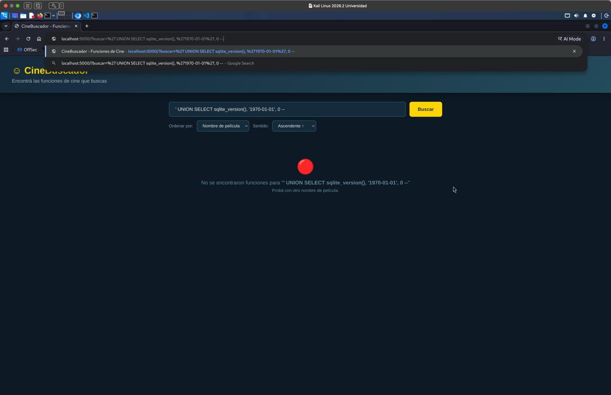

Como se puede observar, el payload sigue apareciendo completo en el buscador, pero ya no se ejecuta.

La aplicación intenta literalmente buscar una película que contenga ese texto.

Tampoco aparece nuevamente la versión de SQLite `3.46.1`, por lo que se comprobó que la inyección dejó de funcionar.

## Ejercicio 2 - Cross Site Scripting

### Identificación y explotación

El segundo ejercicio contiene una vulnerabilidad de Cross Site Scripting o XSS almacenado.

La aplicación permite modificar información de las películas y posteriormente vuelve a mostrar esa información dentro de una página HTML.

El problema principal estaba en la utilización de:

```html
| safe
```

dentro del template de Jinja.

La descripción era mostrada utilizando:

```html
{{ pelicula['descripcion'] | safe }}
```

Por defecto Jinja escapa caracteres HTML que vienen desde variables, pero `safe` le indica explicitamente al motor que el contenido es confiable y que debe insertarlo directamente dentro del HTML.

Esto permite almacenar código JavaScript dentro de la información de una película.

Para comprobarlo utilice un payload como:

```html
<script>alert('Vulnerabilidad XSS explotada')</script>
```

Luego de guardar el contenido y volver a acceder a la película, el navegador interpretó el elemento `<script>` y ejecutó el JavaScript.

El resultado fue el siguiente popup:

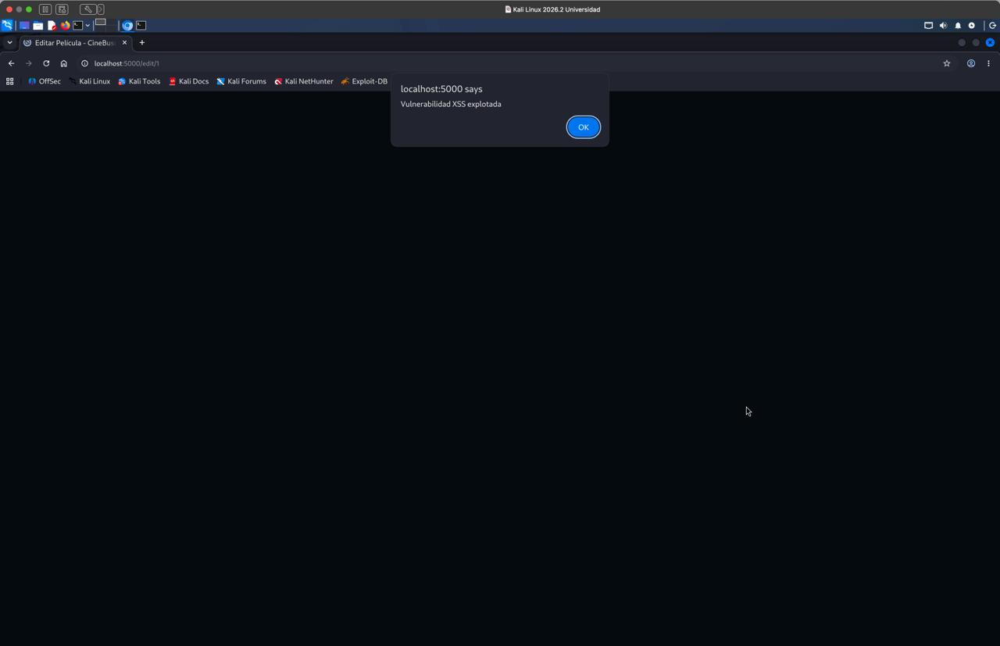

Esto confirmó que era posible almacenar JavaScript dentro de la base de datos y hacer que posteriormente fuera ejecutado por el navegador de cualquier usuario que visualizara la información.

### Mitigación

La mitigación principal consistió en dejar de marcar como seguro el contenido ingresado por el usuario.

Cambie:

```html
{{ pelicula['descripcion'] | safe }}
```

por:

```html
{{ pelicula['descripcion'] }}
```

De esta forma Jinja vuelve a utilizar su mecanismo de escaping automático.

Por ejemplo, un valor como:

```html
<script>alert('Vulnerabilidad XSS explotada')</script>
```

pasa a ser generado dentro del HTML de manera equivalente a:

```html
&lt;script&gt;alert(&#39;Vulnerabilidad XSS explotada&#39;)&lt;/script&gt;
```

Por lo tanto, el navegador lo interpreta como texto y no como una etiqueta HTML ejecutable.

En este ejercicio tuve un problema durante la comprobación de la mitigación.

Inicialmente, luego de hacer los cambios y reconstruir el contenedor, el popup seguía apareciendo.

Para intentar diagnosticarlo utilice:

```bash
grep -RIn "safe" .
```

y posteriormente:

```bash
grep -RInE '\|\s*safe|Markup|mark_safe' .
```

Esto mostró que todavía existía en `templates/edit.html` la línea:

```html
{{ pelicula['descripcion'] | safe }}
```

Por lo tanto, aunque pensaba que ya había solucionado el problema, el cambio no había sido aplicado correctamente sobre esa parte del archivo.

Elimine finalmente `| safe` y reconstruí nuevamente la aplicación, esta vez usando también:

```bash
docker compose down
docker compose build --no-cache
docker compose up -d
```

Luego repetí la prueba utilizando nuevamente:

```html
<script>alert('Vulnerabilidad XSS explotada')</script>
```

La diferencia es que esta vez el texto se mostró literalmente dentro de la página y no apareció ningún popup.

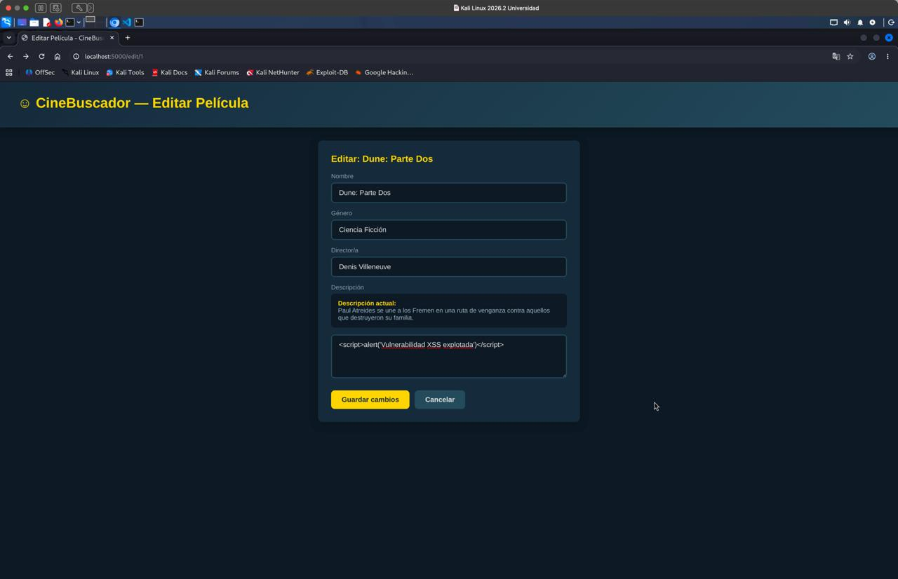

Esto confirmó que el contenido sigue pudiendo ser almacenado, pero dejó de ser interpretado como HTML o JavaScript por el navegador.

También se corrigió en este ejercicio la SQL Injection heredada del Ejercicio 1 utilizando nuevamente consultas parametrizadas.

## Ejercicio 3 - File Upload

### Identificación y explotación

El Ejercicio 3 permite cargar afiches para las películas.

La vulnerabilidad estaba en que el servidor confiaba directamente en el archivo enviado por el usuario.

El código obtenía el nombre original utilizando:

```java
archivo.getOriginalFilename()
```

y posteriormente guardaba el archivo directamente utilizando ese nombre.

No se comprobaba correctamente si el archivo era realmente una imagen.

Para probar la vulnerabilidad cree un archivo denominado:

```text
exploit.html
```

con el siguiente contenido:

```html
<script>alert("File Upload Exploit Exitoso")</script>
```

La aplicación permitía seleccionar el archivo y subirlo como si fuera un afiche.

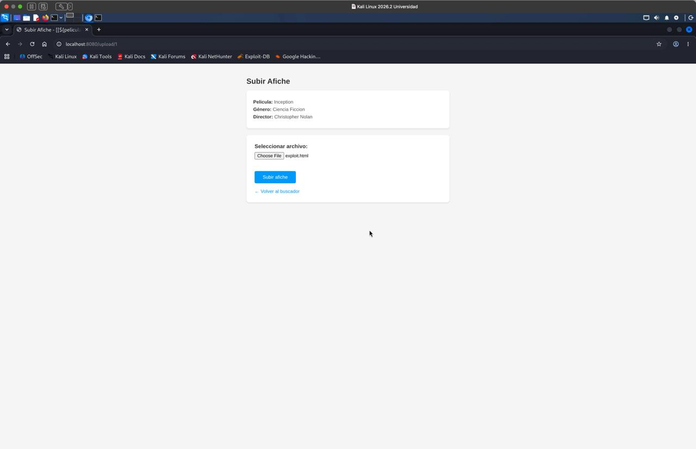

Una vez guardado, el archivo quedaba disponible dentro de la ruta `/uploads/`.

Al acceder directamente mediante:

```text
http://localhost:8080/uploads/exploit.html
```

el navegador interpretó el archivo como HTML y ejecutó el JavaScript.

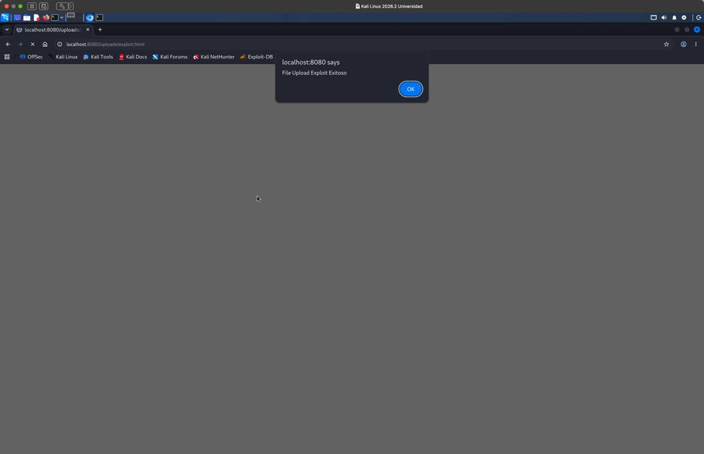

Esto confirmó que un atacante podía utilizar el sistema destinado a imágenes para almacenar contenido activo dentro del servidor y posteriormente hacerlo ejecutar desde el mismo dominio de la aplicación.

### Mitigación

Para solucionar este problema fue necesario hacer más que simplemente limitar la extensión del archivo.

Validar solamente que un archivo termine en `.jpg`, por ejemplo, no es suficiente porque un atacante puede cambiar el nombre de un archivo HTML.

La nueva implementación limita los uploads a un tamaño máximo de 5 MB y solamente permite imágenes PNG o JPEG.

El archivo enviado es procesado mediante `ImageIO`, por lo que el servidor intenta realmente interpretar su contenido como una imagen.

También se comprueban sus dimensiones para evitar imágenes con tamaños anormales.

El nombre enviado por el usuario dejó de utilizarse completamente.

En su lugar, el servidor crea un nombre nuevo mediante un UUID y siempre guarda el resultado como PNG.

Por ejemplo:

```text
550e8400-e29b-41d4-a716-446655440000.png
```

La imagen además es decodificada y posteriormente codificada nuevamente como PNG.

Esto es importante porque incluso si un archivo contiene datos adicionales, el servidor no almacena directamente los bytes enviados por el usuario.

También se configuró la respuesta de los archivos con:

```text
X-Content-Type-Options: nosniff
```

y el endpoint que sirve los uploads solamente acepta nombres generados con el formato utilizado por el servidor.

Para comprobar que la validación no dependiera únicamente de la extensión, reutilice el archivo malicioso anterior pero lo renombre a:

```bash
cp exploit.html exploit.jpg
```

El archivo ahora parecía ser una imagen JPEG por su nombre, pero internamente seguía conteniendo:

```html
<script>alert("File Upload Exploit Exitoso")</script>
```

Intente cargar `exploit.jpg` nuevamente como afiche.

Esta vez la aplicación respondió:

```text
El archivo no es una imagen valida.
```

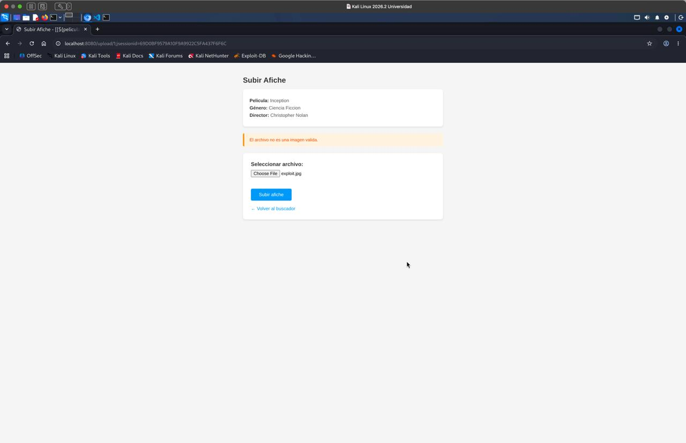

Por lo tanto, incluso modificando la extensión, el archivo no puede superar la validación.

Finalmente también probe cargar una imagen real para asegurarme de que la funcionalidad legítima no hubiera quedado rota.

La imagen fue aceptada y utilizada correctamente como afiche de Inception.

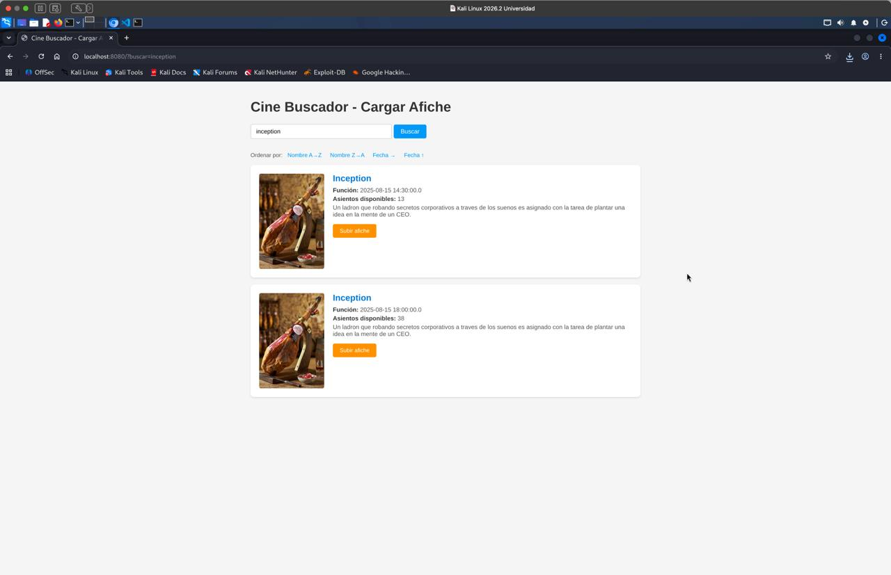

De esta manera se comprobó tanto que el exploit dejó de funcionar como que la funcionalidad normal de carga de imágenes siguió disponible.

## Ejercicio 4 - Server Side Template Injection / SpEL Injection

### Identificación y explotación

El Ejercicio 4 contiene una vulnerabilidad causada por la evaluación de expresiones SpEL provenientes directamente del usuario.

La aplicación utilizaba un `SpelEvaluator` para interpretar lo escrito en el buscador.

Una de las primeras pruebas que realice fue ingresar:

```text
7*7
```

Si el contenido fuera tratado solamente como texto, la aplicación debería intentar buscar literalmente una función denominada `7*7`.

Sin embargo, la aplicación interpretaba la entrada como una expresión matemática.

El resultado de la expresión era:

```text
49
```

y posteriormente la aplicación realizaba la búsqueda utilizando ese resultado.

Esto puede verse en la respuesta obtenida, donde hago un curl mediante la consola a un endpoint que tiene como entrada `7*7`, pero el mensaje generado por el servidor dice:

```text
Resultados buscando por: 49
```

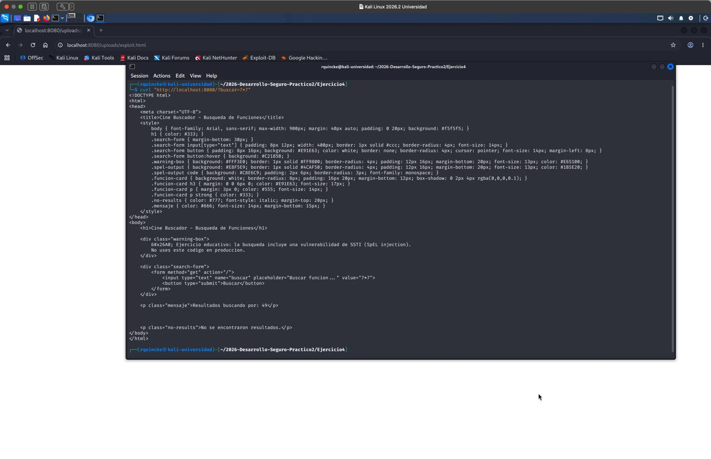

Esto confirmó que la entrada del usuario estaba siendo ejecutada por el motor de expresiones del servidor.

Aunque `7*7` es un ejemplo inofensivo, SpEL permite hacer operaciones considerablemente más peligrosas cuando el contexto de evaluación permite acceso a clases y métodos.

### Mitigación

La solución en este caso no fue intentar crear una lista de expresiones peligrosas.

Decidí directamente eliminar la necesidad de evaluar expresiones.

El archivo:

```text
SpelEvaluator.java
```

fue eliminado completamente.

También se eliminó del controlador cualquier utilización de:

```java
parseExpression()
```

La búsqueda pasó a funcionar como una búsqueda normal mediante Spring Data JPA.

Para buscar funciones por nombre se utiliza ahora un método como:

```java
findByNombreFuncionContainingIgnoreCase(...)
```

Por lo tanto, el texto ingresado por el usuario solamente se utiliza como texto de búsqueda.

Después de reconstruir el contenedor repetí exactamente la prueba:

```text
7*7
```

La aplicación ahora respondió:

```text
No se encontraron coincidencias.
```

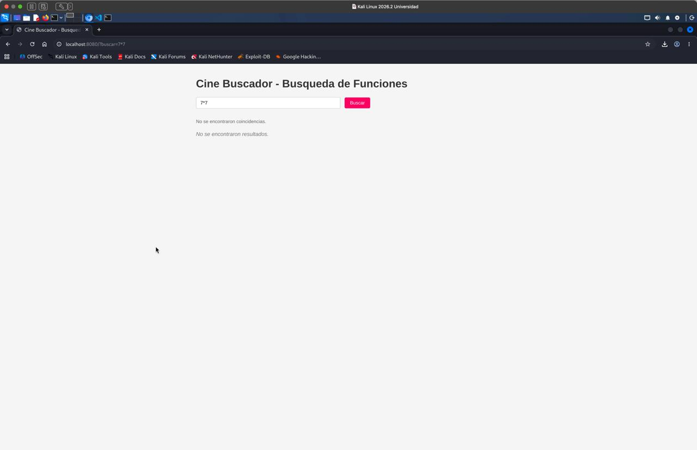

Como se puede ver, el buscador conserva literalmente el valor:

```text
7*7
```

y ya no aparece en ningún momento:

```text
49
```

Esto comprobó que la expresión dejó de ser evaluada.

## Ejercicio 5 - Almacenamiento inseguro de contraseñas

### Identificación y explotación

El último ejercicio contiene una vulnerabilidad relacionada con el almacenamiento de contraseñas.

Al revisar el código encontré una clase denominada:

```text
EncryptionService.java
```

La aplicación utilizaba:

```text
AES/ECB/PKCS5Padding
```

para almacenar las contraseñas de los usuarios.

Además, la clave estaba incluida directamente dentro del código fuente:

```text
MySup3rS3cr3tK3y!2024CineBuscadorAES
```

Debido a que AES es un cifrado reversible, cualquier persona que consiga tanto la contraseña cifrada como la clave puede recuperar la contraseña original.

Esto no es apropiado para almacenar contraseñas.

Para comprobarlo registre un usuario denominado:

```text
test
```

con la contraseña:

```text
123456
```

Luego inicie sesión.

La propia aplicación mostraba la contraseña cifrada dentro de la interfaz.

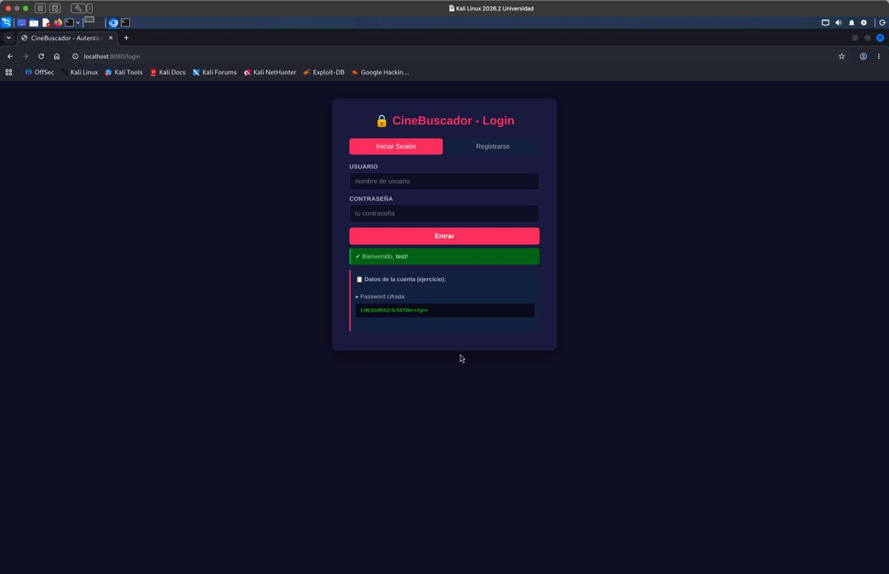

La contraseña cifrada obtenida durante la prueba fue:

```text
tzNLDx9FAZr9/6bfDb++tg==
```

El código además recortaba la clave a los primeros 32 bytes para utilizar AES-256.

Por lo tanto, la clave real utilizada era equivalente a:

```text
MySup3rS3cr3tK3y!2024CineBuscado
```

Durante esta parte tuve un problema para conseguir que OpenSSL descifrara correctamente el valor.

Inicialmente obtenía errores de:

```text
bad decrypt
```

y pensé que existía una diferencia entre el funcionamiento de AES en Java y OpenSSL.

Luego de revisar nuevamente el código y los datos con ayuda de ChatGPT, encontré que la cadena Base64 que había copiado inicialmente tenía un error.

Había utilizado:

```text
tzNLDx9FAZr9/6bF0b++tg==
```

cuando el valor correcto era:

```text
tzNLDx9FAZr9/6bfDb++tg==
```

Una vez corregido, utilice:

```bash
printf 'tzNLDx9FAZr9/6bfDb++tg==' \
| openssl base64 -d -A \
| openssl enc -aes-256-ecb -d \
  -K 4d7953757033725333637233744b3379213230323443696e654275736361646f \
  -nosalt
```

y OpenSSL devolvió:

```text
123456
```

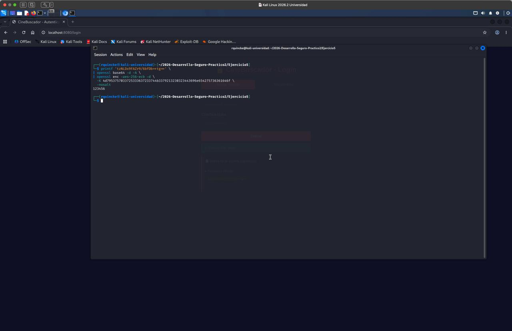

Esto confirmó completamente la vulnerabilidad.

La contraseña almacenada no solamente estaba cifrada de una forma cuestionable, sino que podía ser recuperada en texto plano con la información presente en el propio código fuente.

### Mitigación

Para solucionar el problema elimine completamente:

```text
EncryptionService.java
```

No intente reemplazar AES por otro algoritmo de cifrado porque el objetivo con contraseñas no debería ser poder recuperarlas posteriormente.

En su lugar cree:

```text
PasswordHashService.java
```

utilizando BCrypt.

La configuración utilizada fue:

```java
new BCryptPasswordEncoder(12)
```

El valor `12` corresponde al factor de costo utilizado por BCrypt.

Al registrar un usuario, la contraseña ahora se procesa mediante:

```java
passwordEncoder.encode(rawPassword)
```

y durante el login ya no se descifra nada.

La contraseña ingresada se compara contra el hash almacenado mediante:

```java
passwordEncoder.matches(rawPassword, storedHash)
```

También elimine de la interfaz la sección que anteriormente mostraba la contraseña cifrada.

Para verificar que el nuevo sistema siguiera permitiendo iniciar sesión, registre dos usuarios:

```text
prueba1
prueba2
```

utilizando exactamente la misma contraseña:

```text
123456
```

Luego inicie sesión como `prueba1` y la aplicación permitió el acceso normalmente.

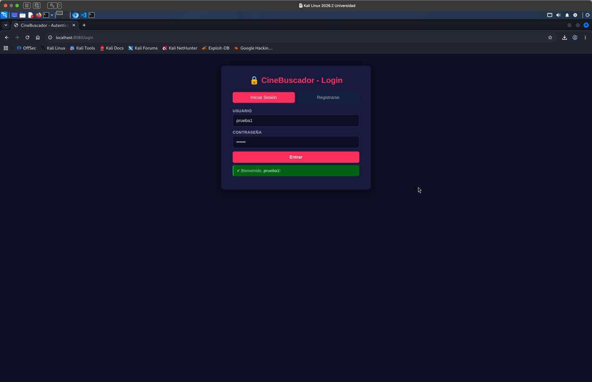

La parte más importante de la comprobación fue revisar como habían quedado almacenadas las contraseñas dentro de H2.

En esta parte también tuve varios problemas.

Primero detuve el contenedor:

```bash
docker compose stop
```

y trate de obtener su ID mediante:

```bash
docker compose ps -q cinebuscador5
```

Pero como el contenedor estaba detenido, ese comando no devolvía nada.

Esto provocaba que:

```bash
docker cp "$(docker compose ps -q cinebuscador5)":/data/cine3.mv.db ./cine3.mv.db
```

fallara con:

```text
must specify at least one container source
```

La solución fue incluir también los contenedores detenidos mediante:

```bash
docker compose ps -aq cinebuscador5
```

y copie finalmente la base utilizando:

```bash
docker cp "$(docker compose ps -aq cinebuscador5)":/data/cine3.mv.db ./cine3.mv.db
```

También copie el JAR de la aplicación:

```bash
docker cp ejercicio5-cinebuscador5-1:/app/app.jar ./app.jar
```

Extraje la librería H2 contenida dentro del JAR:

```bash
mkdir -p h2tool
unzip -j app.jar 'BOOT-INF/lib/h2-*.jar' -d h2tool
```

Inicialmente trate de abrir directamente la base mediante:

```bash
java -cp 'h2tool/*' org.h2.tools.Shell \
  -url 'jdbc:h2:file:./cine3' \
  -user sa \
  -password '' \
  -sql 'SELECT username, password FROM usuarios;'
```

pero H2 respondió:

```text
Wrong user name or password
```

Como alternativa utilice la herramienta de recuperación de H2:

```bash
java -cp 'h2tool/*' org.h2.tools.Recover -dir . -db cine3
```

Esto generó:

```text
cine3.h2.sql
```

Finalmente busque hashes BCrypt mediante:

```bash
grep -nE '\$2[aby]\$12\$' cine3.h2.sql
```

y obtuve:

```text
58:INSERT INTO O_9 VALUES(1, '$2a$12$BGqUKRqYfeF09o8J9VVwduzwuiW4tYzsmrgf.otoFU9guOv6xnx5G', 'prueba1');
59:INSERT INTO O_9 VALUES(2, '$2a$12$sf57nIhas9vTeMIWY5pnkuNIQOiMfRxj/h4vWXwBroHb8aiK1.E4e', 'prueba2');
```

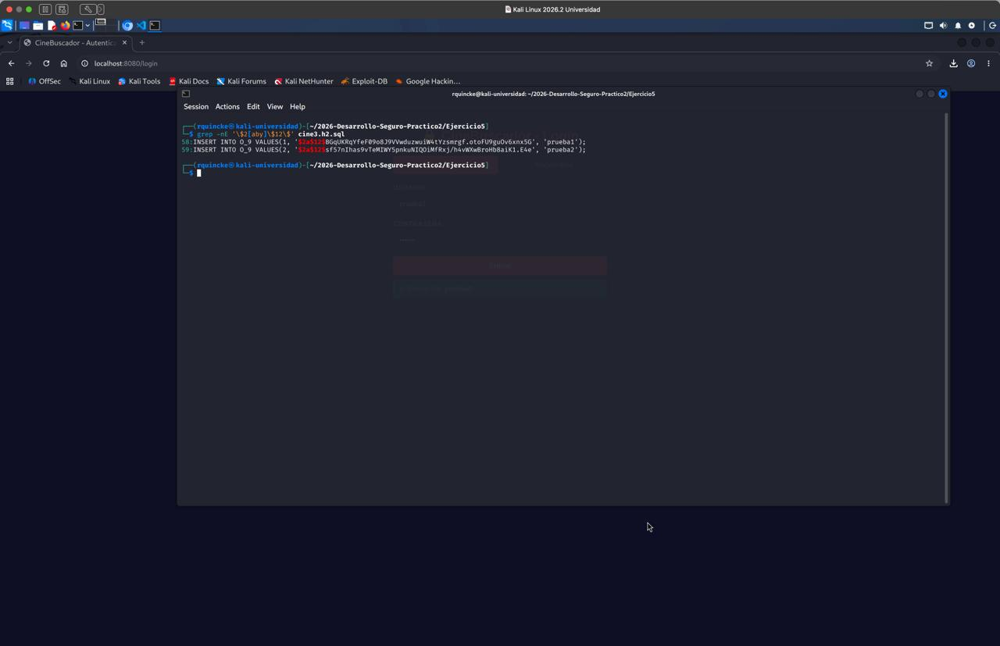

Los dos usuarios utilizaron exactamente la misma contraseña:

```text
123456
```

pero los hashes almacenados son completamente diferentes.

Ambos comienzan además por:

```text
$2a$12$
```

lo cual permite identificar el uso de BCrypt y el factor de costo 12.

La diferencia entre ambos hashes se debe a que BCrypt utiliza un salt aleatorio distinto para cada contraseña.

Por lo tanto, incluso dos usuarios que utilicen la misma contraseña no generan el mismo valor almacenado.

A diferencia del funcionamiento anterior con AES, ya no existe una clave que permita invertir la operación y recuperar directamente:

```text
123456
```

## Uso de Inteligencia Artificial

La Inteligencia Artificial fue utilizada extensivamente durante todo el desarrollo de esta práctica.

En este caso el uso fue considerablemente mayor que durante el práctico anterior, ya que fue utilizada no solamente como ayuda para configurar comandos o solucionar problemas puntuales, sino también para analizar el código fuente, encontrar las vulnerabilidades presentes, entender por que eran vulnerabilidades, generar pruebas de concepto para explotarlas y posteriormente plantear e implementar mitigaciones.

ChatGPT fue utilizado como primera fuente de consulta siempre que aparecía una duda, un error inesperado o una parte del código que se encontraba completamente fuera de mi entendimiento.

Antes de realizar cambios grandes sobre código que no comprendía, primero consulte con la IA qué hacía ese código, por qué era vulnerable, qué alternativas existían para solucionarlo y cuales eran las consecuencias del cambio.

Aunque ChatGPT fue usado extensivamente, no tuvo acceso directo ni control sobre mi máquina virtual.

Todos los comandos fueron ejecutados manualmente por mí, los archivos fueron modificados manualmente y cada una de las soluciones propuestas fue posteriormente comprobada mediante las pruebas mostradas anteriormente.

Cuando alguna recomendación no funcionaba, le proporcione a ChatGPT la salida obtenida o una captura del problema y utilice la respuesta para continuar diagnosticando.

## Conclusión

Al finalizar el práctico se identificaron y explotaron correctamente las cinco vulnerabilidades propuestas.

En el Ejercicio 1 se comprobó una SQL Injection y posteriormente se mitigó mediante consultas parametrizadas y listas de valores permitidos para el ordenamiento.

En el Ejercicio 2 se explotó un XSS almacenado y se solucionó eliminando el uso de `safe` para contenido controlado por usuarios y dejando que Jinja aplique escaping.

En el Ejercicio 3 se consiguió almacenar y ejecutar un archivo HTML utilizando el sistema de carga de afiches. Posteriormente se modificó el sistema para validar el contenido real de las imágenes, generar nombres desde el servidor y volver a codificar las imágenes antes de almacenarlas.

En el Ejercicio 4 se comprobó que una expresión como `7*7` era evaluada mediante SpEL y producía `49`. El evaluador fue eliminado y la entrada pasó a utilizarse exclusivamente como texto de búsqueda.

Finalmente, en el Ejercicio 5 se demostró que una contraseña almacenada mediante AES podía ser recuperada en texto plano utilizando la clave presente en el código fuente. AES fue reemplazado por BCrypt y se comprobó que dos usuarios con la misma contraseña generan hashes diferentes.

Las cinco vulnerabilidades dejaron de ser explotables utilizando las mismas técnicas empleadas durante las pruebas de concepto originales, mientras que las funcionalidades normales de las aplicaciones continuaron funcionando.